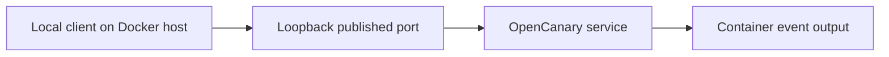

# Lab setup

## Context and known configuration

The conversation discusses a Proxmox home lab and Windows laptop. The exact VM operating system, hardware allocation, network topology and installed versions remain to be recorded.

The following container details come from the existing evidence record:

| Component | Container | Recorded image | Evidence |
|---|---|---|---|
| OpenCanary | neuroaiq-opencanary | thinkst/opencanary:latest | E01 |
| Cowrie | neuroaiq-cowrie | cowrie/cowrie:latest | E01 |

The image tags were recorded as `latest`; the exact image digests and software versions are unknown.

| Service | Recorded host binding | Container port |
|---|---|---|
| HTTP | Loopback:8081 | 80 |
| FTP | Loopback:2121 | 21 |
| MySQL | Loopback:3307 | 3306 |
| Telnet | Loopback:2323 | 23 |
| Cowrie | Loopback:2222 | 2222 |

Cowrie also listed 2223/tcp without a host binding. These bindings support local host access; laptop-to-VM access and public reachability were not established by this evidence.

## Confirmed test path

This diagram describes the recorded local tests. It is not a verified diagram of the complete Proxmox network.

## Details to record next

- Proxmox and guest operating system versions.
- VM identifier, CPU, memory and disk allocation.
- Docker and image versions or digests.
- Sanitized configuration and actual network path.
- Whether the VM address is stable and how it is assigned.
