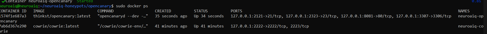
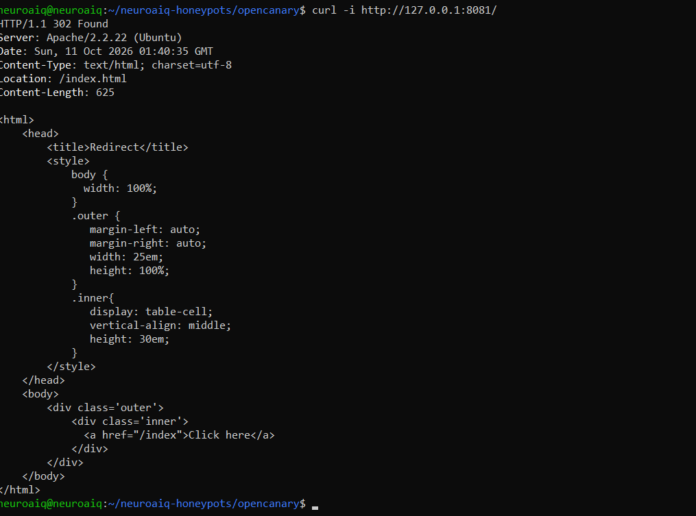
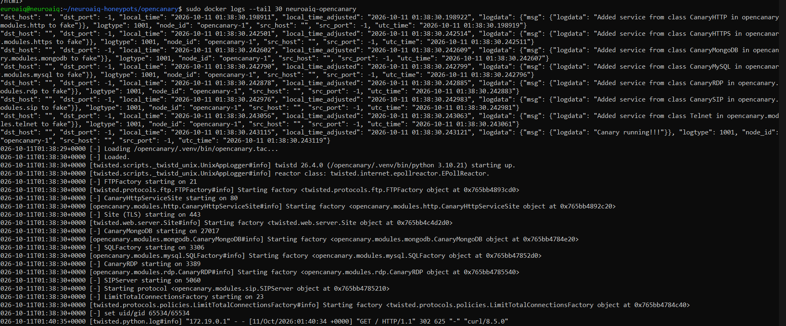
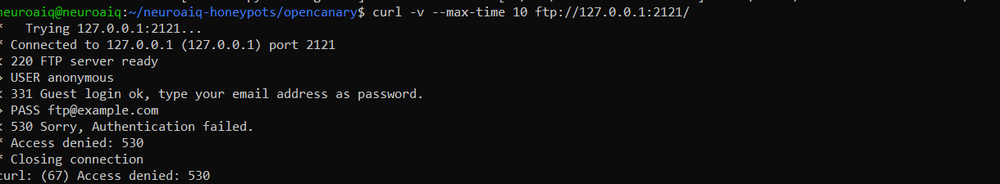
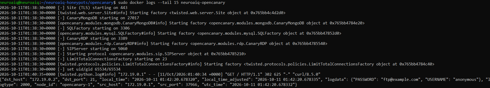
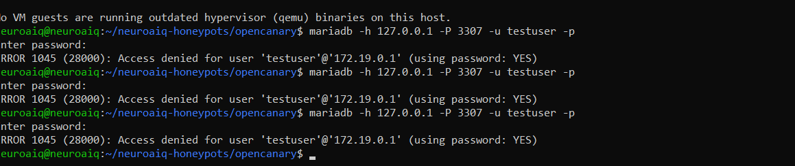

# Screenshot evidence

Reviewed against the original attachments on 11 October 2026. These are original screenshots from the source chat, not frames extracted from screen recordings. Copies below are unchanged; filenames were standardized. The original files have not been modified.

| Evidence | Screenshot | What it shows |
|---|---|---|
| E01 | [Containers](E01-containers.png) | Running OpenCanary and Cowrie containers and loopback bindings |
| E02 | [HTTP response](E02-http-response.png) | HTTP 302 redirect |
| E03 | [HTTP log](E03-http-log.png) | Startup output and matching HTTP request |
| E04 | [FTP response](E04-ftp-response.png) | Anonymous FTP attempt rejected with 530 |
| E05 | [FTP log](E05-ftp-log.png) | Matching FTP event; the visible anonymous placeholder is ftp@example.com |
| E06 | [MySQL response](E06-mysql-response.png) | Three rejected testuser attempts; entered passwords are hidden |
| E10 | [File listing](E10-file-listing.png) | client_sql.iso listing only; contents and availability are not established |

## Pending redaction

E07 (MySQL events), E08 (Telnet interaction with preceding logs), and E09 (Telnet events) were reviewed but not uploaded because they include password values or authentication material. Their descriptions remain in the evidence register; they are not attached evidence yet.

Two screen recordings are also present in the source chat. They are separate media and are not included in this screenshot upload.

## Screenshots

### E01

### E02

### E03

### E04

### E05

### E06

### E10

